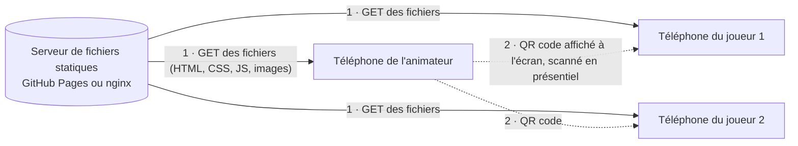

# Fonctionnement technique

Ce document explique comment fonctionne Undercover IA responsable et justifie qu'il s'agit d'une **application non connectée** : aucun serveur applicatif, aucune base de données, aucun échange de données entre les téléphones ni vers un service tiers.

## En résumé

| Question | Réponse |
| --- | --- |
| Y a-t-il un serveur applicatif, une API, une base de données ? | **Non.** Un simple serveur de fichiers statiques (GitHub Pages, nginx…) envoie des fichiers HTML, CSS, JavaScript et images. Il ne reçoit, ne calcule et ne stocke rien. |
| Les téléphones communiquent-ils entre eux ? | **Non.** Chaque téléphone recalcule seul sa carte à partir du code de la partie. |
| Des données sont-elles envoyées quelque part ? | **Non.** L'application ne fait que des requêtes `GET` vers son propre site, pour télécharger ses fichiers. Aucun formulaire n'est envoyé, aucun appel d'API n'existe. |
| Y a-t-il des comptes, des cookies, des traceurs, des statistiques ? | **Non.** Aucun cookie, aucune mesure d'audience, aucune publicité, aucune police ou bibliothèque chargée depuis un autre site. |
| Où sont les données de jeu (prénoms, scores) ? | **Uniquement sur les téléphones** (stockage local du navigateur), et dans les liens/QR codes que les participants s'échangent en présentiel. |
| Est-ce garanti techniquement ? | **Oui.** Une politique de sécurité du contenu (CSP) interdit au navigateur de contacter tout autre site que celui de l'application, et en Kubernetes une NetworkPolicy interdit au serveur toute connexion sortante. |

## Architecture



1. Chaque téléphone télécharge les fichiers de l'application, comme pour n'importe quelle page web. C'est le **seul** trafic réseau.
2. Les informations de la partie passent d'un téléphone à l'autre par un **QR code affiché à l'écran** (ou un lien copié), jamais par le réseau de l'application.

Il n'y a pas de flèche entre les téléphones et le serveur dans l'autre sens : le serveur ne reçoit jamais de donnée de jeu.

## Comment les téléphones jouent sans communiquer

Le jeu repose sur une **distribution déterministe** (`js/game.js`) :

1. L'animateur crée une partie. L'application tire une graine aléatoire et l'assemble avec les paramètres (mode, jeu de cartes, nombre de joueurs, undercovers, règles d'or, ordre, nombre de manches) dans un **code de 8 caractères** (40 bits, dont 6 de somme de contrôle contre les fautes de frappe).
2. Les joueurs reçoivent ce code via le QR code. Chaque téléphone exécute le **même calcul** à partir de *(code, numéro de manche, numéro de joueur)* et obtient exactement la même distribution des cartes que celui de l'animateur.
3. Le passage à la manche suivante se fait de la même façon, sans nouvel échange : chacun appuie sur « Manche suivante ».
4. Pour répartir le rôle d'undercover et la prise de parole, chaque téléphone recalcule aussi les manches précédentes : un joueur qui a déjà eu le rôle a 4 fois moins de chances de l'avoir de nouveau. Le calcul reste identique sur tous les appareils.

Les tests automatiques (`npm test`) vérifient que deux appareils obtiennent toujours la même distribution à partir du même code.

## Ce qui transite dans les liens et QR codes

Les liens de l'application placent leurs informations **après le `#`** (le fragment d'URL) :

| Lien | Contenu après le `#` |
| --- | --- |
| Rejoindre une partie | `join-CODE-N~xxxx` : code de partie, numéro du joueur (facultatif), prénoms encodés en base64url |
| Résultats de fin de partie | `results-CODE~xxxx` : prénoms et issue de chaque manche, encodés en base64url |
| Navigation interne | `#/host/CODE`, `#/play/CODE/3`… |

Le fragment d'URL **n'est jamais transmis au serveur** par le navigateur (RFC 3986, section 3.5). Le serveur ne voit passer que la demande de la page `/`, sans le code, les prénoms ni les scores.

À noter : les prénoms et résultats sont **encodés**, pas chiffrés. Toute personne qui scanne le QR code peut les lire, ce qui correspond à l'usage (des participants réunis dans la même salle).

## Ce qui est stocké sur les téléphones

Tout est stocké dans le `localStorage` du navigateur, sur l'appareil, et n'en sort jamais :

| Clé | Contenu | Appareil |
| --- | --- | --- |
| `host:CODE` | Manche en cours, joueurs éliminés ou désignés, prénoms, résultats des manches | Animateur |
| `hostPrefs` | Derniers réglages de création de partie. Les prénoms saisis ne sont pas remis d'office : un bouton « Reprendre les prénoms de la partie précédente » les propose | Animateur |
| `lastHost` | Code de la dernière partie animée | Animateur |
| `names:CODE` | Prénoms reçus via le QR code | Joueur |
| `player:CODE:N` | Manche affichée par le joueur N | Joueur |
| `lastPlayer` | Dernière partie rejointe | Joueur |
| `lowtech`, `timerDuration`, `debriefDuration` | Préférences d'affichage et durées des minuteurs (débat, discussion du débrief) | Tous |

Le service worker garde aussi une copie des fichiers de l'application (Cache Storage) pour fonctionner hors ligne.

Ces données s'effacent depuis l'application (icône corbeille sur l'accueil, « Supprimer la partie », « Effacer toutes les parties de ce téléphone ») ou en effaçant les données du site dans le navigateur.

## Les requêtes réseau, une par une

Toutes les requêtes sont des `GET` vers le site de l'application :

| Fichiers | Quand |
| --- | --- |
| `index.html`, `css/style.css`, `js/boot.js`, `js/app.js`, `js/game.js`, `js/cards.js`, `js/icons.js` | À l'ouverture |
| `img/dos/regle-N-mini.webp`, `img/dos/regle-N.webp` | Selon les écrans affichés (aucune en mode low-tech) |
| `vendor/qrcode.min.js` | Uniquement sur les écrans qui affichent un QR code (animateur) |
| `sw.js`, `manifest.webmanifest`, `icons/icon.svg` | Service worker et installation sur l'écran d'accueil |

La bibliothèque de QR codes ([qrcode-generator](https://github.com/kazuhikoarase/qrcode-generator), licence MIT) est **hébergée avec l'application** : aucun CDN n'est utilisé.

Le service worker (`sw.js`) ne traite que les requêtes `GET` vers le site lui-même. Il ignore tout le reste et ne contacte aucun autre domaine.

**Seule exception, volontaire :** la page « Pourquoi un Web low-tech ? » contient deux liens vers Low-tech Magazine. Ils ne s'ouvrent que si l'utilisateur les touche, dans un nouvel onglet, sans transmettre l'adresse de la page d'origine (`Referrer-Policy: no-referrer`).

## Les garanties techniques

### Politique de sécurité du contenu (CSP)

`index.html` déclare une CSP, que le serveur nginx de l'image Docker envoie aussi en en-tête HTTP :

```
default-src 'self'; script-src 'self'; style-src 'self'; img-src 'self'; connect-src 'self';
font-src 'none'; object-src 'none'; media-src 'none'; frame-src 'none'; worker-src 'self';
manifest-src 'self'; base-uri 'self'; form-action 'none'
```

Avec cette politique, le navigateur **refuse** de charger un script, une image, une police ou une feuille de style venant d'un autre site. Il refuse aussi d'y envoyer des données (`fetch`, `sendBeacon`, WebSocket) et de soumettre un formulaire. Même un code ajouté par erreur ne pourrait pas faire sortir de données. Pour que cette politique soit stricte, l'application n'a aucun script ni aucun style écrit directement dans le HTML.

L'en-tête HTTP ajoute `frame-ancestors 'none'` (l'application ne peut pas être affichée dans le cadre d'un autre site) et plusieurs en-têtes de durcissement : `X-Content-Type-Options`, `Referrer-Policy`, `Permissions-Policy` (caméra, micro, géolocalisation désactivés), `Cross-Origin-Opener-Policy`, `Cross-Origin-Resource-Policy`. Voir `deploy/nginx/default.conf`.

### Côté serveur (Kubernetes)

La NetworkPolicy `deploy/kubernetes/networkpolicy.yaml` interdit au serveur **toute connexion sortante**, y compris DNS. Le serveur ne peut que répondre aux navigateurs. Il tourne sans droits root, avec un système de fichiers en lecture seule (voir [kubernetes.md](kubernetes.md)).

### Vérification réalisée

Mesures faites le 22/10/2026 dans Chrome (émulation iPhone 13), sur un parcours complet joué dans les quatre combinaisons (coopératif et compétitif, affichage normal et low-tech) : création de partie, QR codes, minuteur, désignations, débrief, fin de partie, joueur qui rejoint, révèle sa carte, change de manche et consulte la fin de partie, mode « Distribuer sur ce téléphone ».

- **Domaines contactés :** un seul, celui de l'application.
- **Méthodes HTTP :** `GET` uniquement.
- **Violations de la CSP :** aucune, la politique n'empêche aucune fonction de l'application.
- **Tentatives volontaires de sortie depuis la page** : `fetch` (POST), `navigator.sendBeacon`, image et script externes, WebSocket. Toutes ont été **bloquées** par le navigateur, et aucune requête n'est partie vers l'extérieur.

### Vérifier soi-même

1. Ouvrir l'application dans un navigateur de bureau, puis les outils de développement, onglet **Réseau**.
2. Jouer une partie : seules des requêtes `GET` vers le domaine de l'application apparaissent.
3. Une fois l'application chargée en HTTPS, **couper le réseau** (mode avion) : la partie continue de fonctionner, puisque le service worker sert les fichiers depuis le cache.

## Ce que voit l'hébergeur

Comme pour tout site web, le serveur de fichiers reçoit l'adresse IP du visiteur, l'heure, le fichier demandé et l'identification du navigateur. Il ne reçoit **ni** le code de partie, **ni** les prénoms, **ni** les scores (voir le fragment d'URL ci-dessus).

- **Sur GitHub Pages**, GitHub conserve ses journaux techniques selon sa propre politique.
- **Sur votre infrastructure**, les journaux d'accès de nginx vont sur la sortie standard du conteneur. Pour ne rien journaliser, ajoutez `access_log off;` dans le bloc `server` de `deploy/nginx/default.conf`.

## Limites assumées

- **Fair-play :** le code de partie permet en théorie de calculer les cartes de tous les joueurs, comme on pourrait regarder la carte d'un voisin dans un jeu physique.
- **Scores côté animateur uniquement :** les scores sont tenus sur son téléphone, faute de serveur. Les joueurs les reçoivent en scannant le QR code des résultats.
- **Mode hors ligne :** il nécessite HTTPS, ce qui est le cas sur GitHub Pages et derrière un ingress TLS.
